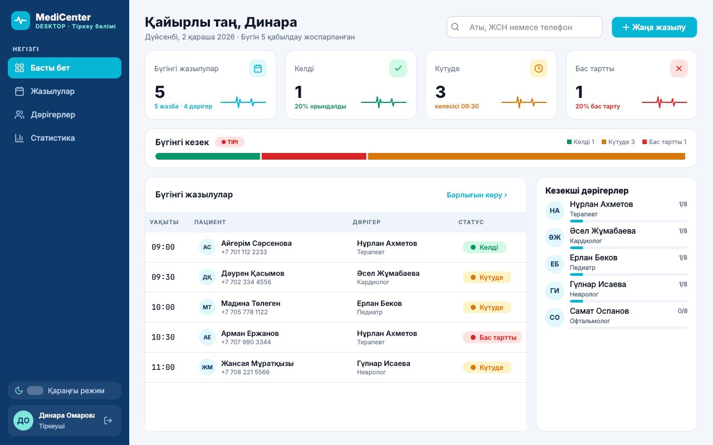
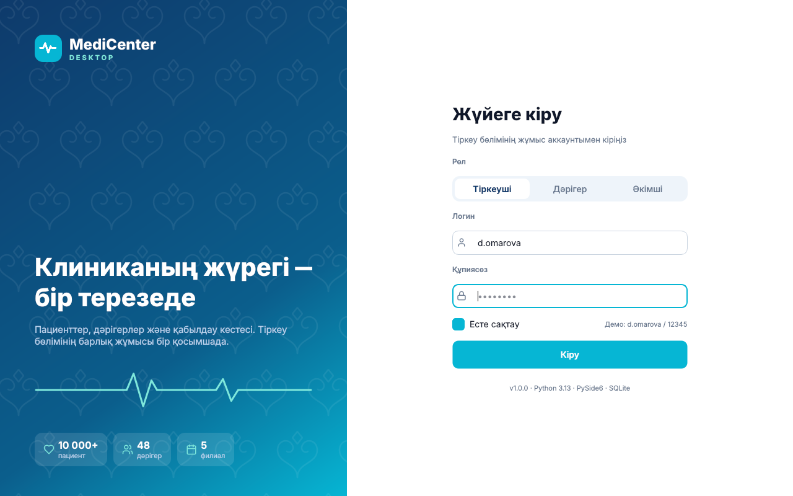
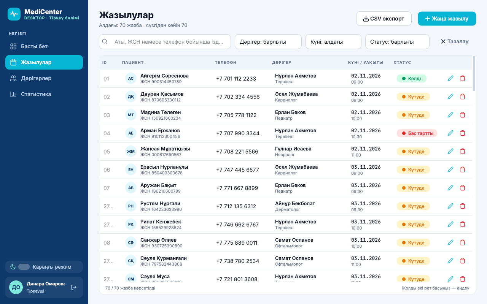
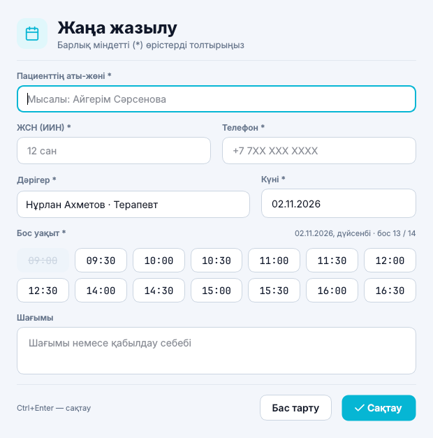
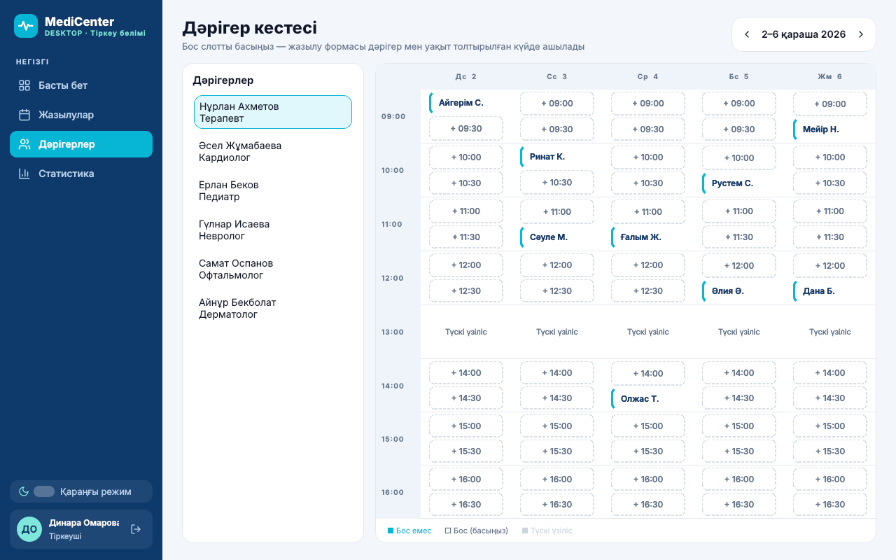
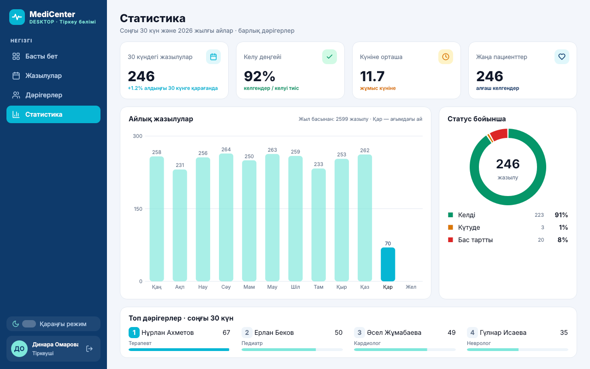
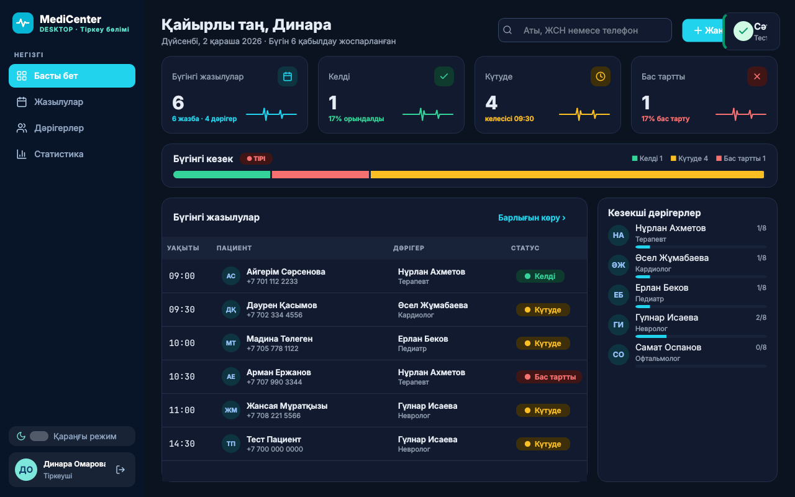

# MediCenter Desktop

Клиника тіркеу бөліміне (регистратура) арналған десктоп қосымша. **Python 3.10+ және PySide6**.
Дизайн Figma-дағы макет бойынша жасалған: [MediCenter Desktop (Figma)](https://www.figma.com/design/s08s4i5a43fjXWDyCV33hH).
Түстер, компоненттер және терезелер Figma-дағымен бірдей (Light / Dark айнымалылары `theme.py` ішінде).



## Іске қосу

```bash
cd desktop
pip install -r requirements.txt
python main.py
```

Алғаш іске қосқанда `medicenter.db` (SQLite) файлы өзі құрылады: 6 дәрігер, Figma-дағы 10 жазба және статистикаға арналған тарих.

| Рөл | Логин | Құпиясөз |
| --- | --- | --- |
| Тіркеуші | `d.omarova` | `12345` |
| Дәрігер | `n.akhmetov` | `12345` (тек өз жазылуларын көреді) |
| Әкімші | `admin` | `admin123` |

## Терезелер (Figma → код)

| № | Терезе | Файл / класс | PySide6 виджеттері |
| --- | --- | --- | --- |
| 01 | Кіру (рөл таңдау, ою фоны) | `app.py` → `LoginWindow` | QLineEdit, QPushButton, QCheckBox |
| 02 | Басты терезе (статистика, «тірі» кезек, бүгінгі жазылулар) | `pages.py` → `DashboardPage` | QMainWindow, QStackedWidget, QTableWidget |
| 03 | Жаңа жазылу (бос уақыт слоттары, валидация) | `dialogs.py` → `AppointmentDialog` | QDialog, QDateEdit, QComboBox, QTextEdit |
| 04 | Жазылулар: іздеу, сүзгі, CSV экспорт | `pages.py` → `AppointmentsPage` | QTableWidget, QLineEdit, QComboBox, QFileDialog |
| 05 | Жазбаны өңдеу (статус ауыстыру) | `dialogs.py` → `AppointmentDialog(record=...)` | QDialog |
| 05b | Жоюды растау | `dialogs.py` → `confirm_delete` | QMessageBox |
| 06 | Дәрігер кестесі (апта, бос слотты басу → жазылу) | `pages.py` → `DoctorsPage` | QListWidget, QTableWidget |
| 07 | Статистика (айлық график, статус диаграммасы, топ дәрігерлер) | `pages.py` → `StatsPage`, `widgets.py` → `BarChart`, `Donut` | QPainter |
| 08 | Қараңғы режим | `theme.py`, `MainWindow.apply_theme` | QSS, QSettings |

## Функциялар

1. Рөл бойынша жүйеге кіру (құпиясөз SHA-256 хэшпен сақталады)
2. Пациентті жазу (аты-жөні, ЖСН, телефон)
3. Қабылдауға жазылу: тек бос уақытты таңдауға болады
4. Жазылуларды кестеде қарау
5. Аты, ЖСН немесе телефон бойынша іздеу
6. Дәрігер, күн, статус бойынша сүзу
7. Жазбаны өңдеу
8. Жазбаны растаумен жою
9. Статус белгілеу: Күтуде / Келді / Бас тартты
10. Дәрігердің апталық кестесі
11. Статистика және графиктер
12. CSV-ке экспорт (Excel ашады)
13. Жарық / қараңғы режим (таңдау есте сақталады)

Бір уақытқа бір дәрігерге тек бір пациент жазылады: бұл `UNIQUE(doctor_id, date, time)` шектеуімен дерекқорда тексеріледі.

## Құрылымы

```
desktop/
├── main.py                    # кіру нүктесі
├── medicenter_desktop/
│   ├── app.py                 # LoginWindow, MainWindow, run()
│   ├── pages.py               # Dashboard, Appointments, Doctors, Stats беттері
│   ├── dialogs.py             # жазылу диалогы, жоюды растау
│   ├── widgets.py             # Figma компоненттері: Button, StatusChip, Card, Toast, Sidebar, ECG, графиктер
│   ├── theme.py               # Light / Dark түстері және QSS
│   └── db.py                  # SQLite: кестелер, демо деректер, барлық SQL сұраулары
├── tests/test_db.py           # python -m unittest discover -s tests
└── docs/screenshots/          # терезелердің скриншоттары
```

## .exe жинау (Windows)

```bash
pip install pyinstaller
pyinstaller --noconsole --onefile --name MediCenterDesktop main.py
```

## Скриншоттар

| | |
| --- | --- |
|  |  |
|  |  |
|  |  |
